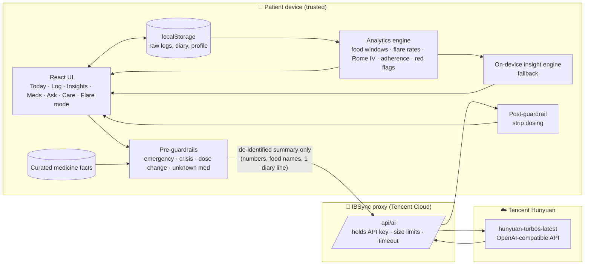

# IBSync

**Other IBS apps help you keep a diary. IBSync turns that diary into a better doctor visit, with medicines that make sense and food that's actually Singaporean.**

Tencent Cloud × AI Singapore "AI CAN DO IT" Hackathon 2026 · Healthcare track (NTU LKC Medicine) · **Challenge Statement 2: AI Healthier Every Day, Intelligent Support for Long-Term Self-Care**

---

## Why IBSync (our edge)

There are already many IBS apps. Here's what we found when we looked at them, and where IBSync is different.

| Type | Examples | What they do | What they miss |
|---|---|---|---|
| Food and symptom diaries | mySymptoms, Cara Care (English version), myIBS | Logging, some pattern-finding, exports | Don't focus on medicines, Western food lists, English-first |
| Gut-brain therapy programmes | Nerva (now includes Mahana's CBT content), Lin Health | Hypnotherapy or CBT courses | US-focused, about US$199 a year, not tracking or care coordination |
| Clinician-led care programmes | Oshi, Ayble, Salvo | Virtual visits with specialists | Need US insurance, limited to some US states |
| FODMAP food tools | Monash, Fig, Spoonful | Food data and barcode scanning | Food only |

Some features overlap: myIBS includes a Rome IV questionnaire, and mySymptoms exports reports. Our edge isn't one feature. It's the combination, built for Singapore. We didn't find an app that does all five of these:

1. **It's designed around the care journey, not just tracking.** IBSync covers both people who *think* they might have IBS and people managing a diagnosis. It produces a GP-ready summary mapped to the Rome IV symptom criteria doctors use, questions to bring, and a schedule of appointments, tests and check-ups. This fits Singapore's Healthier SG push towards an ongoing relationship with one family doctor.
2. **It does medicines properly, which the diaries mostly don't.** It covers all three medicine features in the challenge statement:
   - **Understanding:** a plain-language explanation of each medicine, and an honest "I'm not able to identify that medication, please check with your pharmacist" when it doesn't recognise one.
   - **Management:** your own medicines, dose times, as-needed doses and refill countdowns.
   - **Adherence:** taken-rate for each dose time (e.g. "your 18:45 dose is taken 64% of the time"), the reason behind each missed dose ("eating out, forgot to bring it"), and a tip for that specific reason.
3. **It's local where it matters.**
   - Hawker dishes are broken down into likely trigger ingredients. Kopi with condensed milk counts as dairy plus caffeine, so the app can say the problem is the dairy, not the coffee. That matters because lactose intolerance is very common among East and South Asians.
   - It works in English, 中文, Bahasa Melayu and தமிழ்.
   - It points people to local help: 995, the SOS hotline on 1767, polyclinics and CHAS subsidies.
4. **The AI is designed to be trusted.** The numbers come from code and the AI only explains them, so it can't invent statistics.
   - Fixed safety rules run before the AI sees anything: emergencies, crisis language, dose-change questions and unknown medicines.
   - Dosing instructions are removed from AI replies, and it never claims to diagnose.
   - The AI only receives a de-identified summary. Everything else stays on the phone, and the app still works with no AI connection at all.
5. **It has a realistic route to real users.** Instead of selling to the public, polyclinics or Healthier SG family doctors recommend IBSync, and patients bring the summary to the visit (B2B2C). This is the opposite of the US insurance-based model above.

**How the edge lines up with the judging criteria**

| Criterion | Where IBSync scores |
|---|---|
| Impact & Relevance | Closes the loop from daily life to the consult; serves undiagnosed people, not just diagnosed patients |
| Human-Centred Design / UX & Accessibility | Four languages, three text sizes, simpler-wording mode, reduced motion, status shown by shape as well as colour, calm palette, Flare mode |
| AI Interaction | Grounded overview, plan for today, insight for each section, doctor questions, chat in the user's language |
| Responsible AI & Ethics | Numbers from code, fixed safety rules, honest about what it doesn't know, never diagnoses, de-identified AI payload, works offline |
| Innovation & Creativity | Breaking dishes into trigger ingredients; diagnosis diary mapped to Rome IV |
| Feasibility | Local-first storage, any OpenAI-compatible model (Tencent Hunyuan by default), clinic recommendation route |

---

## Submission copy (ready to paste)

**Project title:** IBSync

**Short blurb (under 10 words):** Turning your IBS diary into better doctor visits.

**Project description:**

*Overview: scenarios, users, value.* IBS affects an estimated 4–10% of people worldwide (depending on diagnostic criteria) and most often starts between the teens and the 40s, which are the years of exams, first jobs and eating out. Many people live with symptoms for months before seeing a doctor, then arrive at a short consult unable to describe what's been happening. Plenty of IBS apps already exist, but they are mostly food diaries or US-based therapy and care programmes. We didn't find one built around Singapore's food, languages and clinics, or one that handles medicines and appointment preparation together. IBSync connects what happens between visits to what happens in the consult. It serves both people who think they might have IBS (a structured symptom diary for their GP) and people managing a diagnosis (triggers, medicines, check-ups).

*Real-world pain points.*
1. Trigger foods are personal and show up 2–6 hours later, so a 9am kopi rarely gets linked to 11am bloating. Western food apps don't have hawker dishes.
2. Antispasmodics have to be taken *before* meals, and evening doses get missed when people eat out.
3. Clinic visits are short, and patients forget what happened over the last 3 months.
4. Alarm symptoms (blood, weight loss, night-time symptoms) get normalised as "just my IBS".
5. Existing apps feel clinical, use alarming reds, and are English-only.

*Solution design.*
- **Two journeys:** "I think I might have IBS" builds a diary that maps onto the Rome IV symptom criteria, with a GP-ready PDF. IBSync never says "you have IBS", and it warns people not to cut out gluten before a coeliac test. "I've been diagnosed" focuses on triggers, medicines and reviews.
- **Track in under 10 seconds:** meals from a local food catalogue (kopi, laksa, chicken rice…), plus your own dishes tagged by ingredient. Also a pain slider with friendly faces, a non-graphic Bristol stool picker, stress, sleep, water, movement, and a diary.
- **Deterministic analytics engine** (`src/lib/analytics.js`): symptoms in the 45 minutes to 6 hours after each food and ingredient, flare-rate comparisons for stress, sleep, movement and water, the Rome IV stool pattern and diary check, adherence for each dose time with missed-dose reasons, and alarm-feature detection.
- **AI layer** (Tencent Hunyuan through an OpenAI-compatible endpoint): it rephrases the engine's numbers into an at-a-glance overview, a plan for today, insights for each section, doctor questions and a grounded chat, in English, 中文, Bahasa Melayu or தமிழ். The prompts (`src/ai/prompts.js`) only allow claims backed by USER_DATA and explanations from the curated MEDICINE_FACTS.
- **Guardrails** (`src/ai/guardrails.js`): fixed safe responses for emergencies (995), crisis language (SOS 1767), dose changes and unidentifiable medicines. Dosing instructions are removed from model output.
- **Medicines:** your own medicines and dose times, plain-language explanations, adherence for each dose time, the reason behind each miss, and refill countdowns.
- **Care:** your own appointments, tests and check-ups with repeat schedules, suggested preventive items, AI-drafted questions, a red-flag checklist and a one-page clinician PDF.
- **Flare mode:** a dimmed, low-stimulus screen with paced breathing, comfort steps, gentle foods, your own triggers to skip, and when to seek urgent care.

*Business value.*
- **For patients:** better-prepared visits, because the PDF summarises 28 days into a 2-minute read. Adherence becomes measurable for each dose time, with the barrier behind each miss. Alarm features get escalated earlier.
- **Route to market:** B2B2C through polyclinics and Healthier SG family doctors, who recommend the app while patients bring the summary.
- **Extends to:** other chronic GI conditions (IBD, GERD).
- **Example pilot targets:** +15 percentage points of evening-dose adherence, fewer self-reported flare days after 8 weeks, and at least 80% of patients bringing a summary to follow-up.

---

## Who it's for

- **People diagnosed with IBS:** find personal triggers, keep medicines on track, prepare for reviews.
- **People who think they might have IBS:** build a structured symptom diary that maps onto the Rome IV symptom criteria GPs use (pain frequency, link to bowel movements, change in stool frequency and form), with a GP-ready PDF. IBSync never says "you have IBS". It shows what the diary contains and encourages a GP visit, plus tests such as a coeliac screen before anyone cuts out gluten.

People choose their situation on first launch and can change it any time in Settings.

## Make it yours

- **Your own foods:** add any dish in the meal logger and tag what's in it (dairy, garlic/onion, wheat…), so the trigger engine can still work out which ingredient is behind it.
- **Your own medicines and schedules:** set any number of dose times, or mark a medicine "as needed", and track doses left. Recognised medicines get a plain-language explanation; unrecognised ones still get reminders, with an honest "ask your pharmacist".
- **Your own appointments, tests and check-ups:** set a date, time and place, and choose whether it repeats (3, 6 or 12 months). "Done" rolls a repeating item forward. Suggested check-ups can be added in one tap.

## Run it

```bash
npm install
cp .env.example .env      # optional: add AI_API_KEY for live Hunyuan
npm run dev               # http://localhost:5173
```

Production (e.g. Tencent Cloud Lighthouse / CVM / CloudBase Run):

```bash
npm run build
AI_API_KEY=... PORT=8080 npm start
```

**There's no AI key? It still works.** Every AI surface has an on-device fallback (`src/ai/localEngine.js`) that builds the same outputs from the analytics numbers, so the demo can't break on stage. Each AI text shows its source ("AI · hunyuan-turbos-latest", "On-device insight" or "Safety response").

The app ships with 4 weeks of realistic demo data that has discoverable patterns: dairy, garlic/onion and coconut meals → symptoms; an exam-stress week → flares and loose stools; walking days → fewer flares; missed evening doses when eating out. Settings → Reset demo data restores it.

---

## Architecture



### Trust boundaries

| Boundary | What crosses it | What never crosses it |
|---|---|---|
| Device → proxy | `compactForLLM()` output: 7-day numbers, food names, rates, latest diary line, medicine labels | Name, raw event log, full diary, timestamps beyond day labels |
| Proxy → Hunyuan | Same payload + system prompt; the key is added server-side | Browser never sees the API key |
| Model → user | Text passes the post-filter (dose instructions removed) and is shown with its source label | Model output never changes data, medicines or reminders |

### Key design trade-offs

1. **Numbers come from code; words come from AI.** Correlations are computed deterministically, so they're auditable and reproducible, and the LLM only explains them. This rules out hallucinated statistics, at the cost of fewer "creative" insights.
2. **Rules before the model for safety-critical routes.** Emergencies and dose changes never reach the LLM. The latency is zero and the behaviour is guaranteed, but the phrasing is less flexible.
3. **Closed medicine knowledge.** The assistant can explain only medicines in the curated KB and abstains otherwise ("I'm not able to identify that medication…"). That makes coverage narrower but safe.
4. **Local-first storage.** Health logs stay on the device (PDPA-friendly, nothing to breach). The trade-off is no cross-device sync yet; a production version would add encrypted sync on Tencent Cloud.
5. **Association, not causation.** The 45–360 min post-meal window and a minimum of 3 meals before a verdict reduce false triggers, and users can override any food verdict.

---

## Challenge requirements → features

| Requirement | Where |
|---|---|
| Medication understanding | Meds → "Understand your medicines", lookup, Ask chat (KB-grounded, abstains on unknown) |
| Medication management | Today/Meds dose list, as-needed logging, refill countdown |
| Adherence support | Adherence ring + per-slot %, "What got in the way?" barrier capture + tailored tips |
| Health tracking | Log (meal, symptoms, Bristol, water, movement, stress, sleep, diary), Insights tabs, Timeline |
| Preventive health | Care → check-ups & prevention, red-flag checklist, plan for today |
| Healthcare preparation | Care → AI questions, concerns list, "Ask my doctor this" from chat, clinician PDF |
| Safe / strictly bounded / honest about uncertainty | Guardrails, fixed safety responses, source labels, "still learning" verdicts |
| Personalised & longitudinal | All insights from the user's own 28-day history; week-over-week comparisons |
| Accessible (teens–40s, all backgrounds) | 4 languages, 3 text sizes, simpler-wording mode, reduce motion, shape+colour status (never colour alone), 44px+ targets, gender-neutral design |

---

## Design system

Four switchable themes (Settings → Colour theme), all sharing one token set in `src/index.css`:

| Theme | Background | Primary | Accent | Use |
|---|---|---|---|---|
| **Oat & Moss** (default) | `#F8F6F0` | `#4E8273` | `#B96E4A` | Warm, friendly |
| **Sage Clinic** | `#EBF1EE` | `#2F6B5E` | `#C27650` | Calmer, clinic-adjacent |
| **Clay** | `#F7F0E8` | `#A55F3C` | `#4E7F71` | Earthy, terracotta-led |
| **Espresso** (dark) | `#1C1917` | `#8EC0AF` | `#DDA07C` | Night use; also powers Flare mode |

Severity always runs moss → amber → brick (never alarm red), and each level also has its own shape (● calm, ■ mild, ▲ flare). Typeface: Nunito (rounded, self-hosted), with Noto Sans SC and Noto Sans Tamil fallbacks. The signature element is the **pebble week**, where each day of the week is a soft stone coloured by how the gut felt.

---

## Data sources & references

- Trigger patterns modelled on the Monash University low-FODMAP framework and IBS literature on lactose and FODMAP sensitivity and the gut–brain axis.
- Stool subtype: Rome IV criteria (share of Bristol types 1–2 vs 6–7).
- Alarm features: Rome IV / NICE CG61 red flags.
- For model validation at scale, open datasets such as MIMIC-III (PhysioNet) or Kaggle IBS/food-symptom datasets can be used to calibrate trigger windows.

## Competitor sources

- Lin Health, "Best Apps For IBS In 2026": https://www.lin.health/insights/best-apps-ibs
- Mindset Health (Nerva), "Compare IBS apps and programs": https://start.nervahealth.com/compare/ibs-apps

Both pages are published by companies that make IBS apps, so we treated them as starting points, not neutral rankings.

## Built with

React 19, Vite, Tailwind CSS v4, Recharts, date-fns, jsPDF, lucide-react · Tencent Hunyuan (OpenAI-compatible API) · developed with **Tencent CodeBuddy** (see `/docs` for conversation-log screenshots).

> IBSync explains and organises. It does not diagnose or change treatment.
