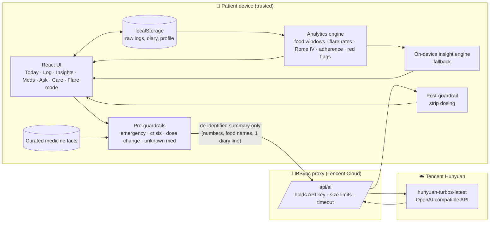

# IBSync

**An AI companion that turns everyday IBS tracking into clear patterns, steady routines and better doctor visits.**

Tencent Cloud × AI Singapore "AI CAN DO IT" Hackathon 2026 · Healthcare track (NTU LKC Medicine) · **Challenge Statement 2: AI Healthier Every Day, Intelligent Support for Long-Term Self-Care**

---

## Submission copy (ready to paste)

**Project title:** IBSync

**Short blurb (under 10 words):** Your AI gut companion: track, understand, and calm IBS.

**Project description:**

*Overview: scenarios, users, value.* IBS affects an estimated 4–10% of people worldwide (depending on diagnostic criteria) and most often starts between the teens and the 40s, which are the years of exams, first jobs and eating out. Patients juggle food triggers, unpredictable bowel habits, stress, and several medicines, but most of them track nothing, or track in a notes app that never tells them anything back. IBSync is a mobile-first companion that brings logging, pattern-finding, medicine understanding, adherence support and appointment preparation into one calm, low-stress app built around Singapore's hawker food and healthcare system.

*Real-world pain points.* (1) Trigger foods are personal and delayed by 2–6 hours, so patients can't link a 9am kopi to 11am bloating. (2) Antispasmodics have to be taken *before* meals, and evening doses get missed when people eat out. (3) Clinic visits are short, and patients forget what happened over the last 3 months. (4) Alarm symptoms (blood, weight loss, night-time symptoms) get normalised as "just my IBS". (5) Existing apps feel clinical, use alarming reds, and are English-only.

*Solution design.*
- **Track in under 10 seconds:** meals from a local food catalogue (kopi, laksa, chicken rice…), a pain slider with friendly faces, a non-graphic Bristol stool picker, stress, sleep, water, movement, and a free-text diary.
- **Deterministic analytics engine** (`src/lib/analytics.js`): a 45–360 min post-meal symptom window for each food and ingredient, flare-rate comparisons for stress, sleep, movement and water, the Rome IV stool-pattern subtype, adherence by dose slot with missed-dose reasons, and alarm-feature detection.
- **AI layer** (Tencent Hunyuan through an OpenAI-compatible endpoint): it rephrases the engine's numbers into an at-a-glance overview, a plan for today, per-tab insights, doctor questions and a grounded chat. The prompts (`src/ai/prompts.js`) require the model to cite only USER_DATA, explain medicines only from the curated MEDICINE_FACTS, say "seems linked" instead of "causes", and reply in the user's language (English, 中文, Bahasa Melayu or தமிழ்).
- **Guardrails** (`src/ai/guardrails.js`): before any model call, emergencies, crisis language, dose-change questions and unidentifiable medicines get fixed, safe responses (995, SOS 1767, "check with your pharmacist"). After the model call, any dosing instruction is stripped out.
- **Flare mode:** a dimmed, low-stimulus screen with paced breathing, comfort steps, gentle foods, the user's own triggers to skip, and when to seek urgent care.
- **Care:** appointment countdown, AI-drafted questions, a red-flag checklist, preventive items (coeliac test, FODMAP reintroduction, FIT from age 50, flu vaccine), and a one-page clinician PDF.

*Business value.* Visits are better prepared, because the PDF summarises 28 days into a 2-minute read. Adherence can be measured per dose slot, with the barrier behind each miss. Earlier escalation of alarm features. It can extend to clinics (B2B2C: polyclinics or GI clinics prescribe the app, and patients share the PDF or a FHIR export) and to other chronic GI conditions (IBD, GERD). Example targets for a pilot: +15 percentage points of evening-dose adherence, fewer self-reported flare days after 8 weeks, and ≥80% of patients bringing a summary to follow-up.

---

## Run it

```bash
npm install
cp .env.example .env      # optional: add AI_API_KEY for live Hunyuan
npm run dev               # http://localhost:5173
```

Production (e.g. Tencent Cloud Lighthouse / CVM / CloudBase Run):

```bash
npm run build
AI_API_KEY=... PORT=8080 npm start
```

**There's no AI key? It still works.** Every AI surface has an on-device fallback (`src/ai/localEngine.js`) that builds the same outputs from the analytics numbers, so the demo can't break on stage. Each AI text shows its source ("AI · hunyuan-turbos-latest", "On-device insight" or "Safety response").

The app ships with 4 weeks of realistic demo data that has discoverable patterns: dairy, garlic/onion and coconut meals → symptoms; an exam-stress week → flares and loose stools; walking days → fewer flares; missed evening doses when eating out. Settings → Reset demo data restores it.

---

## Architecture



### Trust boundaries

| Boundary | What crosses it | What never crosses it |
|---|---|---|
| Device → proxy | `compactForLLM()` output: 7-day numbers, food names, rates, latest diary line, medicine labels | Name, raw event log, full diary, timestamps beyond day labels |
| Proxy → Hunyuan | Same payload + system prompt; the key is added server-side | Browser never sees the API key |
| Model → user | Text passes the post-filter (dose instructions removed) and is shown with its source label | Model output never changes data, medicines or reminders |

### Key design trade-offs

1. **Numbers come from code; words come from AI.** Correlations are computed deterministically, so they're auditable and reproducible, and the LLM only explains them. This rules out hallucinated statistics, at the cost of fewer "creative" insights.
2. **Rules before the model for safety-critical routes.** Emergencies and dose changes never reach the LLM. The latency is zero and the behaviour is guaranteed, but the phrasing is less flexible.
3. **Closed medicine knowledge.** The assistant can explain only medicines in the curated KB and abstains otherwise ("I'm not able to identify that medication…"). That makes coverage narrower but safe.
4. **Local-first storage.** Health logs stay on the device (PDPA-friendly, nothing to breach). The trade-off is no cross-device sync yet; a production version would add encrypted sync on Tencent Cloud.
5. **Association, not causation.** The 45–360 min post-meal window and a minimum of 3 meals before a verdict reduce false triggers, and users can override any food verdict.

---

## Challenge requirements → features

| Requirement | Where |
|---|---|
| Medication understanding | Meds → "Understand your medicines", lookup, Ask chat (KB-grounded, abstains on unknown) |
| Medication management | Today/Meds dose list, as-needed logging, refill countdown |
| Adherence support | Adherence ring + per-slot %, "What got in the way?" barrier capture + tailored tips |
| Health tracking | Log (meal, symptoms, Bristol, water, movement, stress, sleep, diary), Insights tabs, Timeline |
| Preventive health | Care → check-ups & prevention, red-flag checklist, plan for today |
| Healthcare preparation | Care → AI questions, concerns list, "Ask my doctor this" from chat, clinician PDF |
| Safe / strictly bounded / honest about uncertainty | Guardrails, fixed safety responses, source labels, "still learning" verdicts |
| Personalised & longitudinal | All insights from the user's own 28-day history; week-over-week comparisons |
| Accessible (teens–40s, all backgrounds) | 4 languages, 3 text sizes, simpler-wording mode, reduce motion, shape+colour status (never colour alone), 44px+ targets, gender-neutral design |

---

## Design system

Four switchable themes (Settings → Colour theme), all sharing one token set in `src/index.css`:

| Theme | Background | Primary | Accent | Use |
|---|---|---|---|---|
| **Oat & Moss** (default) | `#F8F6F0` | `#4E8273` | `#B96E4A` | Warm, friendly |
| **Sage Clinic** | `#EBF1EE` | `#2F6B5E` | `#C27650` | Calmer, clinic-adjacent |
| **Clay** | `#F7F0E8` | `#A55F3C` | `#4E7F71` | Earthy, terracotta-led |
| **Espresso** (dark) | `#1C1917` | `#8EC0AF` | `#DDA07C` | Night use; also powers Flare mode |

Severity always runs moss → amber → brick (never alarm red), and each level also has its own shape (● calm, ■ mild, ▲ flare). Typeface: Nunito (rounded, self-hosted), with Noto Sans SC and Noto Sans Tamil fallbacks. The signature element is the **pebble week**, where each day of the week is a soft stone coloured by how the gut felt.

---

## Data sources & references

- Trigger patterns modelled on the Monash University low-FODMAP framework and IBS literature on lactose and FODMAP sensitivity and the gut–brain axis.
- Stool subtype: Rome IV criteria (share of Bristol types 1–2 vs 6–7).
- Alarm features: Rome IV / NICE CG61 red flags.
- For model validation at scale, open datasets such as MIMIC-III (PhysioNet) or Kaggle IBS/food-symptom datasets can be used to calibrate trigger windows.

## Built with

React 19, Vite, Tailwind CSS v4, Recharts, date-fns, jsPDF, lucide-react · Tencent Hunyuan (OpenAI-compatible API) · developed with **Tencent CodeBuddy** (see `/docs` for conversation-log screenshots).

> IBSync explains and organises. It does not diagnose or change treatment.
